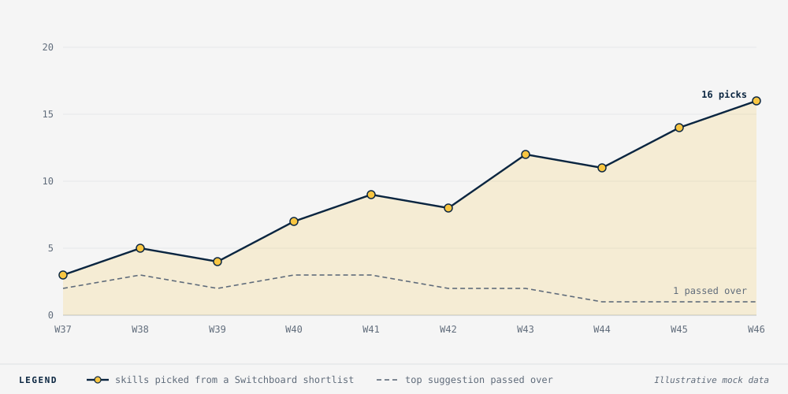
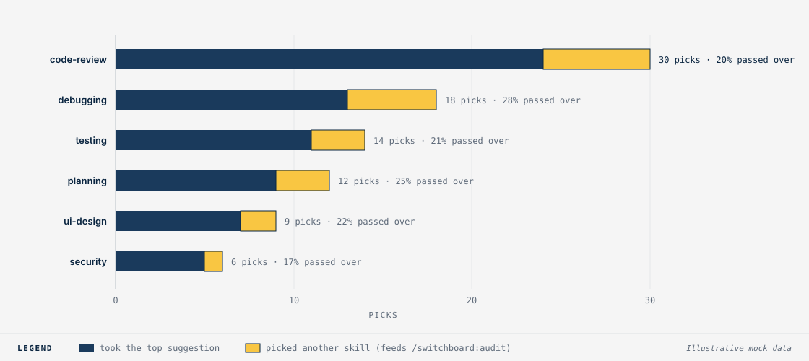

# Switchboard

[](https://github.com/surenganne/switchboard/actions/workflows/test.yml)

**Pick the right skill when several fit.** A local router for Claude Code skills and plugins.

You install skills and plugins from many places, and plenty of them overlap: five code reviewers, three
debuggers, a few planners. Claude Code sees only each skill's one-line description, so it picks between
overlapping skills almost at random.

Switchboard profiles every installed skill from its full files. When two or more of them fit the task in
front of you, it shows you the best two or three, each with a one-line reason, and lets you pick.

- **Asks only when it matters.** If one skill clearly fits, Claude uses it and says which.
- **Fit decides the order.** Your past picks appear as labels ("you chose this last time"). They never
  change the ranking.
- **Local only.** No network, no API keys, no telemetry. Python 3 standard library.



## Contents

- [Install](#install) · [First run](#first-run) · [How it works](#how-it-works) · [Commands](#commands)
- [What you'll see](#what-youll-see) · [Activity report](#activity-report) · [Privacy](#privacy)
- [Limits](#limits-in-v02) · [Uninstall](#uninstall) · [Development](#development)

## Install

```sh
claude plugin marketplace add surenganne/switchboard
claude plugin install switchboard@switchboard
```

To try a local checkout instead, pass its path: `claude plugin marketplace add ./switchboard`.

Restart Claude Code. Requires `python3` (3.9 or newer) on your `PATH`.

## First run

```
/switchboard:profile
```

Claude reads each skill and writes a short, fixed-format profile (category, what it works on, focus, depth,
cost, stack). It shows you the count and a rough token cost before starting, and runs in parallel
subagents. Later sessions profile only new or changed skills; the session start message tells you when
some are waiting.

## How it works

| Step | Who | What happens |
|---|---|---|
| **1 · Scan** | Switchboard | At session start, a hook lists your user, project and enabled-plugin skills and commands, and fingerprints each one (its main file plus every `.md` in its folder). |
| **2 · Profile** | Claude | `/switchboard:profile` has Claude fill a fixed schema per skill. A validator accepts only known fields, values from fixed lists and short text, so a skill's own text cannot steer the router. |
| **3 · Route** | Claude + Switchboard | Before Claude uses a skill in a task area where several profiled skills overlap, it describes the task (category, targets, focus, stack) to the local `route` tool, which scores the candidates. If Claude skips this step, a hook reminds it once. |
| **4 · Pick** | You | Claude shows the top two or three with a one-line reason each, and you choose. |
| **5 · Learn** | Switchboard | Your pick is logged locally, shown as a label on similar tasks later, and feeds `/switchboard:audit` and the activity report. |

Skills you name yourself (typing `/review` or `/ecc:code-review` in your message) are never routed: a prompt
hook notes the names you typed, and the routing reminder lets those skills straight through for the session.

**When a plugin updates,** the fingerprint of any skill whose text changed no longer matches its profile.
That skill is marked as changed, the next session start offers `/switchboard:profile`, and only the
changed skills are re-profiled. A version bump that leaves a skill's text alone does not trigger anything.

## Commands

| Command | What it does |
|---|---|
| `/switchboard:profile` | Profile new or changed skills |
| `/switchboard:status` | Counts and overlapping task areas |
| `/switchboard:audit` | Task types where you keep passing over the top pick |
| `/switchboard:report` | Build a local HTML report of your activity (see below) |
| `/switchboard:forget` | Delete your choice history (asks first) |

## What you'll see

The examples below are illustrative: skill names, counts and dates are made up, and Claude words its replies
in its own way. The data formats are exact.

### At session start

When skills are new or changed since they were last profiled:

```
Switchboard: 12 skills are new or changed since they were profiled.
Run /switchboard:profile to update them.
```

### `/switchboard:profile`

Claude asks before spending tokens:

```
Switchboard has 12 skills to profile (~36k tokens, one subagent per batch of about 20).
  ● Profile all 12
  ○ Not now
```

And reports when the batches finish:

```
Profiled 12 of 12 skills, none failed.
Task areas that now overlap: code-review, debugging, planning, testing, ui-design.
```

Each profile is a small JSON file in `~/.switchboard/profiles/`. A real one:

```json
{
  "id": "superpowers:systematic-debugging",
  "source": "superpowers",
  "content_hash": "558107fd6ae5f43f",
  "categories": ["debugging"],
  "does": "Four-phase debugging process that requires finding the root cause before any fix: investigate, compare patterns, test a hypothesis, then fix.",
  "targets": ["files", "repo"],
  "focus": ["correctness", "reliability"],
  "depth": "thorough",
  "cost": "single-pass",
  "stack": ["any"],
  "best_for": ["bugs and test failures", "flaky tests and unexpected behavior", "after failed quick fixes"],
  "not_for": ["new feature design", "code review"]
}
```

### When several skills fit a task

You ask *"review this PR before I merge it"*, and three code reviewers are installed:

```
Several installed skills fit this. Which one?

  1. review (recommended)       Pre-landing PR review for SQL safety, trust boundaries and side effects.
                                You chose this last time.
  2. ecc:code-review            Broad quality, security and maintainability pass over the diff.
  3. ponytail:ponytail-review   Flags over-engineering and code that should not exist.
```

Your answer is appended to `~/.switchboard/choices.jsonl` as one line of task features and skill ids,
never your prompt:

```json
{"date": "2026-11-12", "category": "code-review", "targets": ["pr"], "focus": ["correctness", "security"], "stack": ["python"], "depth": null, "cost": null, "offered": ["user:review", "ecc:code-review", "ponytail:ponytail-review"], "chosen": "user:review"}
```

### `/switchboard:status`

```
Switchboard knows 86 skills: 86 profiled, 0 waiting.
Task areas with overlapping skills: code-review, debugging, docs, planning, testing, ui-design.
```

### `/switchboard:audit`

Task types where you passed over the top suggestion at least twice, so you can check whether those
profiles are wrong:

```
- debugging · files · correctness: top pick passed over 3 times; you chose superpowers:systematic-debugging.
- planning · docs: top pick passed over 2 times; you chose ecc:plan, superpowers:writing-plans.
Re-profiling these skills (/switchboard:profile) may help if their profiles look off.
```

### `/switchboard:report`

```
Wrote ~/.switchboard/report.html (89 picks across 86 installed skills).
Open it with: open ~/.switchboard/report.html
```

### `/switchboard:forget`

```
Delete your local choice history (choices.jsonl)? Profiles are kept.
  ● Delete my choice history
  ○ Keep it

Removed 89 entries.
```

## Activity report

`/switchboard:report` writes `~/.switchboard/report.html` and tells you its path. Open it in any browser
(`open ~/.switchboard/report.html` on macOS). The page is one self-contained file: no scripts, nothing
loaded from the network, readable only by you (mode 0600). It shows:

- installed skills, how many are profiled, picks recorded, and how often you passed over the top suggestion
- picks per week (up to the last 26 weeks)
- the most chosen skills, as times chosen out of times offered
- picks and overrides by task area
- task types where you keep passing over the top pick, with the skills you chose instead
- profiling coverage by source, and how many profiles are out of date
- every profiled skill with its categories, a one-line description and times chosen / offered, most
  chosen first (collapsed by default; search it with your browser's Find)

Two of its views, drawn here from illustrative mock data:





It follows your system's light or dark setting. Run the command again whenever you want fresh numbers;
the activity sections stay empty until you have picked a skill from a Switchboard suggestion.

## Privacy

Everything lives in `~/.switchboard/`. Directories are mode 0700 and files 0600.

| File | Holds |
|---|---|
| `inventory.json` | Installed skill ids, names, paths, descriptions, hashes |
| `profiles/*.json` | One profile per skill |
| `choices.jsonl` | Per pick: date, task features (category, targets, focus, stack, depth, cost), skills offered, skill chosen |
| `state/` | Per session: reminder-hook timestamps and the skill names you typed as `/name` (names only, never the message); deleted after a day |
| `report.html` | The latest activity report, written only when you run `/switchboard:report` |
| `last_offer.json` | A hash of the unprofiled-skill list, so you are offered profiling only when it changes |

No prompt text and no code are stored. Feature fields keep only values from the fixed lists. To stop
recording choices, create `~/.switchboard/settings.json` with `{"record_choices": false}`.

## Limits in v0.2

- Claude Code only. The scanner sits behind a small interface (`list_skills`) so other platforms can follow.
- Built-in Claude Code skills (such as `code-review` and `simplify`) have no files on disk, so they are not
  routed.
- Skills and plugin commands only; MCP tools and subagents are not routed.
- Fingerprints cover a skill's `.md` files only, so an update that changes only its scripts does not mark it
  for re-profiling.

## Uninstall

```sh
claude plugin uninstall switchboard@switchboard
rm -rf ~/.switchboard
```

## Development

```sh
git clone https://github.com/surenganne/switchboard.git && cd switchboard
python3 -m unittest discover -s tests -t .
```

The README images are exported SVGs in `docs/images/`; their editable HTML sources are in `docs/diagrams/`.

## License

MIT
