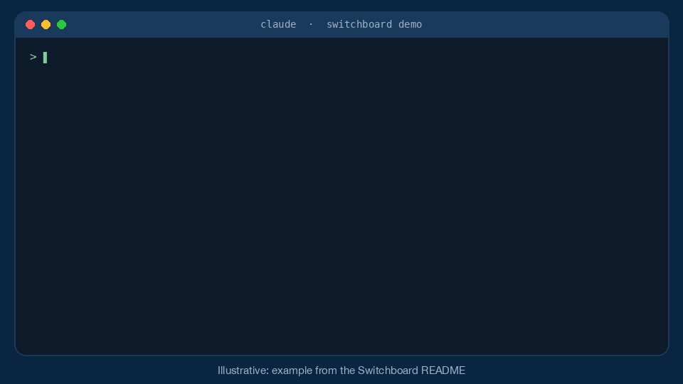

# Switchboard

[](https://github.com/surenganne/switchboard/actions/workflows/test.yml)
[](https://github.com/surenganne/switchboard/releases)
[](LICENSE)


**A Claude Code plugin that picks the right skill when several installed skills fit the same task.**
Local only: no network, no API keys, no telemetry, Python standard library.

```sh
claude plugin marketplace add surenganne/switchboard
claude plugin install switchboard@switchboard
# restart Claude Code, then run: /switchboard:profile
```



<sub>Illustrative: a re-creation of the example below, not a recording of a real session.</sub>

You install skills and plugins from many places, and plenty of them overlap: five code reviewers, three
debuggers, a few planners. Claude Code sees only each skill's one-line description, so it picks between
overlapping skills almost at random.

Switchboard profiles every installed skill from its full files. When two or more of them fit the task in
front of you, it shows you the best two or three, each with a one-line reason, and lets you pick.

- **Asks only when it matters.** If one skill clearly fits, Claude uses it and says which.
- **Fit decides the order.** Your past picks appear as labels ("you chose this last time") and only break
  ties between equally good fits; they never lift a weaker fit above a better one. Skills built for another
  language (a Kotlin reviewer on a Python task) rank below those that fit any stack.
- **Local only.** No network, no API keys, no telemetry. Python 3 standard library.

You ask *"review this PR before I merge it"*, and three code reviewers are installed:

```
Several installed skills fit this. Which one?

  1. review (recommended)       Pre-landing PR review for SQL safety, trust boundaries and side effects.
                                You chose this last time.
  2. ecc:code-review            Broad quality, security and maintainability pass over the diff.
  3. ponytail:ponytail-review   Flags over-engineering and code that should not exist.
```



## Contents

- [Install](#install) · [First run](#first-run) · [How it works](#how-it-works) · [Commands](#commands)
- [What you'll see](#what-youll-see) · [Privacy](#privacy) · [Reference](docs/reference.md)
- [Limits](#limits) · [Update](#update) · [Uninstall](#uninstall) · [Development](#development)

## Install

```sh
claude plugin marketplace add surenganne/switchboard
claude plugin install switchboard@switchboard
```

To try a local checkout instead, pass its path: `claude plugin marketplace add ./switchboard`.

Restart Claude Code. Requires `python3` (3.9 or newer) on your `PATH`.

## First run

```
/switchboard:profile
```

Claude reads each skill and writes a short, fixed-format profile (category, role, what it works on, focus, depth,
cost, stack). It shows you the count and a rough token cost before starting, and runs in parallel
subagents. Later sessions profile only new or changed skills; the session start message tells you when
some are waiting.

## How it works

| Step | Who | What happens |
|---|---|---|
| **1 · Scan** | Switchboard | At session start, a hook lists your user, project and enabled-plugin skills, commands and agents (subagents), and fingerprints each one (a skill's main file plus every `.md` in its folder; a command's or agent's own file). |
| **2 · Profile** | Claude | `/switchboard:profile` has Claude fill a fixed schema per skill. A validator accepts only known fields, values from fixed lists and short text, so a skill's own text cannot steer the router. |
| **3 · Route** | Claude + Switchboard | Before Claude uses a skill in a task area where several profiled skills overlap, it describes the task (category, role, targets, focus, stack) to the local `route` tool. Skills whose role matches the task (`performs` by default; `assists` for help around a task, such as answering review comments) rank first, then by how much of the task each covers. `route` returns up to 10 candidates, each with its kind and how to start it (the Skill tool, or the Agent tool for an agent), and tells Claude to offer the best 2–3 with AskUserQuestion. If Claude skips routing or asking, a hook blocks the skill until a choice is recorded (at most twice per 10 minutes, so it never gets stuck). By default Agent calls are not blocked, since skills start agents mid-workflow; they are only logged for hygiene (see [`enforce`](docs/reference.md#the-enforce-setting) for `primary` mode). When your prompt looks like work in an overlapping area (review, debugging, tests, new features, refactors, release…), a prompt hook also reminds Claude to route even if it was about to do the work without a skill; the prompt is matched in memory and never stored. |
| **4 · Pick** | You | Claude shows the top two or three with a one-line reason each, and you choose. |
| **5 · Learn** | Switchboard | Your pick is logged locally, shown as a label on similar tasks later, and feeds `/switchboard:audit` and the activity report. |

Skills you name yourself (typing `/review` or `/ecc:code-review` in your message) are never routed: a prompt
hook notes the names you typed, and the routing reminder lets those skills straight through for the session.

**When a plugin updates,** the fingerprint of any skill whose text changed no longer matches its profile.
That skill is marked as changed, the next session start offers `/switchboard:profile`, and only the
changed skills are re-profiled. A version bump that leaves a skill's text alone does not trigger anything.

To also hold edits and agent calls until routing has happened, see
[the `enforce` setting](docs/reference.md#the-enforce-setting) (`primary` mode).

## Commands

| Command | What it does |
|---|---|
| `/switchboard:profile` | Profile new or changed skills, and backfill roles for profiles saved before v0.3 |
| `/switchboard:status` | Counts and overlapping task areas |
| `/switchboard:audit` | Task types where you keep passing over the top pick |
| `/switchboard:report` | Build a local HTML report of your activity ([details](docs/reference.md#activity-report)) |
| `/switchboard:hygiene` | Suggest unused plugins and skills to turn off, with the context tokens each would save |
| `/switchboard:forget` | Delete your choice and usage history (asks first) |

## What you'll see

Example output for session start and every command is in
[docs/reference.md](docs/reference.md#what-youll-see).

## Privacy

Everything lives in `~/.switchboard/`. Directories are mode 0700 and files 0600.

Each file and what it holds: [docs/reference.md](docs/reference.md#privacy-files-in-switchboard).

No prompt text and no code are stored. Feature fields keep only values from the fixed lists. To stop
recording, create `~/.switchboard/settings.json` with `{"record_choices": false}` and/or
`{"record_usage": false}`. Past session transcripts are never read.

## FAQ

**Why not just write better skill descriptions?** Claude Code chooses between skills from their one-line
descriptions. Skills that come from someone else's plugin aren't yours to rewrite, and a one-liner can't carry
a skill's depth, cost or the stack it was built for. Switchboard profiles each skill from its full files and
shows which one you picked last time, so overlapping skills are compared on more than a sentence.

## Limits

The main ones:

- `Bash` is not gated (it cannot tell a read from a write), so a shell command that writes files is not caught.
- Claude Code only. The scanner sits behind a small interface (`list_skills`) so other platforms can follow.
- Fingerprints cover a skill's `.md` files only, so an update that changes only its scripts does not mark it
  for re-profiling.

Full list: [docs/reference.md](docs/reference.md#limits).

## Update

```sh
claude plugin marketplace update switchboard   # fetch the latest catalog
claude plugin update switchboard@switchboard   # install the newer version
```

Restart Claude Code to load it. Updates follow the `version` in `.claude-plugin/plugin.json`: a release that
does not bump it is not picked up. Your profiles and choices in `~/.switchboard` are kept; skills whose text
changed are offered for re-profiling at the next session start.

Each version is listed under [Releases](https://github.com/surenganne/switchboard/releases): a merge to
`main` that bumps `version` (in both `.claude-plugin/plugin.json` and `switchboard/mcp_server.py`) is tagged
and released by `.github/workflows/release.yml`, with notes listing the PRs since the previous release.

From a local checkout (`claude plugin marketplace add ./switchboard`), pull or edit the checkout, then run
the same two commands.

## Uninstall

```sh
claude plugin uninstall switchboard@switchboard
rm -rf ~/.switchboard
```

## Development

```sh
git clone https://github.com/surenganne/switchboard.git && cd switchboard
python3 -m unittest discover -s tests -t .
```

The README images are exported SVGs in `docs/images/`; their editable HTML sources are in `docs/diagrams/`.

Contributions are welcome; see [CONTRIBUTING.md](CONTRIBUTING.md).

## License

MIT
