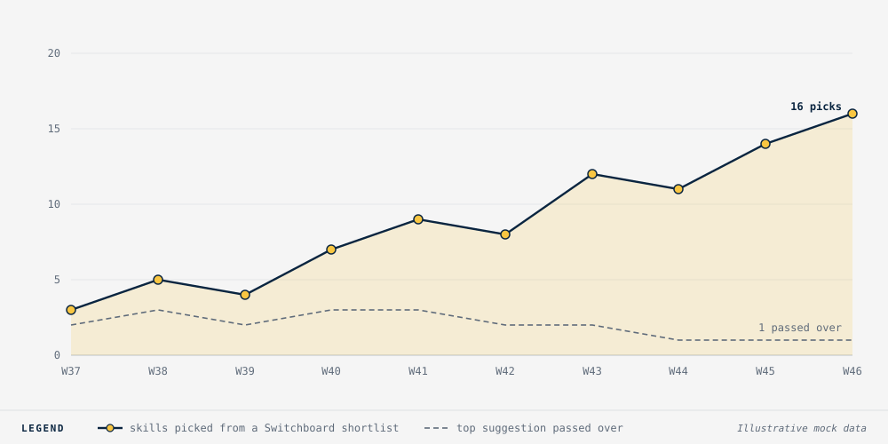
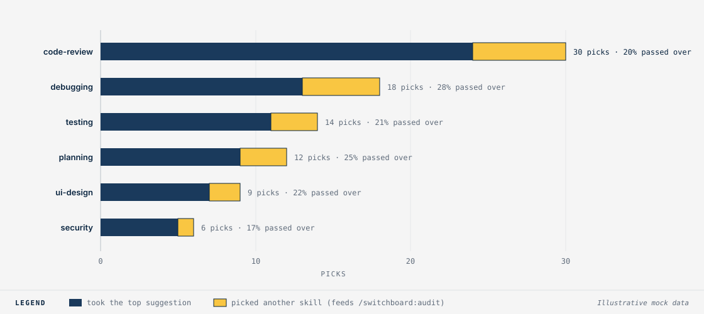

# Switchboard reference

Detail moved out of the [README](../README.md) to keep it short. Nothing here changed in the move.

## The `enforce` setting

`enforce` in `~/.switchboard/settings.json` (or `$SWITCHBOARD_HOME/settings.json`) sets how much Switchboard holds back until routing has happened:

| Value | Effect |
|---|---|
| `"off"` | No gating; the reminder hook still runs. |
| `"skills"` (default) | Only the Skill tool is gated, as described in [How it works](../README.md#how-it-works). Unknown or invalid values fall back to this. |
| `"primary"` | Also gates the first `Edit`, `Write`, `NotebookEdit` and `Agent`/`Task` call, when your prompt touched a task area where several installed skills overlap, until a choice is recorded. |

```json
{"enforce": "primary"}
```

In `primary` mode the gate holds until `record_choice` is called, then stays quiet for 10 minutes; after that, a later prompt that touches an overlap area gates again. `record_choice` also accepts `direct`: you declined every skill and Claude does the work itself. It counts as a recorded choice and is not counted as an override in `/switchboard:audit`. The cap is the same as for skills: at most 2 denials per session per 10 minutes, so an agent that cannot ask you is never stuck. `Read`, `Grep`, `Glob` and `Bash` are never gated, nor is any `Edit`, `Write` or `NotebookEdit` under `~/.switchboard`, so you can always turn this off through Claude. Skills you typed as `/name` are never gated.

## What you'll see

The examples below are illustrative: skill names, counts and dates are made up, and Claude words its replies
in its own way. The data formats are exact.

### At session start

When skills or agents are new or changed since they were last profiled:

```
Switchboard: 12 skills or agents are new or changed since they were profiled.
Run /switchboard:profile to update them.
```

### `/switchboard:profile`

Claude asks before spending tokens:

```
Switchboard has 12 skills to profile (~36k tokens, one subagent per batch of about 20).
  ● Profile all 12
  ○ Not now
```

And reports when the batches finish:

```
Profiled 12 of 12 skills, none failed.
Task areas that now overlap: code-review, debugging, planning, testing, ui-design.
```

Each profile is a small JSON file in `~/.switchboard/profiles/`. A real one:

```json
{
  "id": "superpowers:systematic-debugging",
  "source": "superpowers",
  "content_hash": "558107fd6ae5f43f",
  "categories": ["debugging"],
  "does": "Four-phase debugging process that requires finding the root cause before any fix: investigate, compare patterns, test a hypothesis, then fix.",
  "targets": ["files", "repo"],
  "focus": ["correctness", "reliability"],
  "depth": "thorough",
  "cost": "single-pass",
  "stack": ["any"],
  "best_for": ["bugs and test failures", "flaky tests and unexpected behavior", "after failed quick fixes"],
  "not_for": ["new feature design", "code review"]
}
```

### When several skills fit a task

You ask *"review this PR before I merge it"*, and three code reviewers are installed:

```
Several installed skills fit this. Which one?

  1. review (recommended)       Pre-landing PR review for SQL safety, trust boundaries and side effects.
                                You chose this last time.
  2. ecc:code-review            Broad quality, security and maintainability pass over the diff.
  3. ponytail:ponytail-review   Flags over-engineering and code that should not exist.
```

Your answer is appended to `~/.switchboard/choices.jsonl` as one line of task features and skill ids,
never your prompt (`chosen` is the skill id, or the literal `direct` when you declined every skill):

```json
{"date": "2026-11-12", "category": "code-review", "targets": ["pr"], "focus": ["correctness", "security"], "stack": ["python"], "depth": null, "cost": null, "offered": ["user:review", "ecc:code-review", "ponytail:ponytail-review"], "chosen": "user:review"}
```

### `/switchboard:status`

```
Switchboard knows 160 entries (86 skills, 4 commands, 70 agents): 160 profiled, 0 waiting.
Task areas with overlapping skills: code-review, debugging, docs, planning, testing, ui-design.
```

### `/switchboard:audit`

Task types where you passed over the top suggestion at least twice, so you can check whether those
profiles are wrong:

```
- debugging · files · correctness: top pick passed over 3 times; you chose superpowers:systematic-debugging.
- planning · docs: top pick passed over 2 times; you chose ecc:plan, superpowers:writing-plans.
Re-profiling these skills (/switchboard:profile) may help if their profiles look off.
```

### `/switchboard:report`

```
Wrote ~/.switchboard/report.html (89 picks across 86 installed skills).
Open it with: open ~/.switchboard/report.html
```

### `/switchboard:hygiene`

From v0.4 Switchboard logs which skills you use (skill id and date only), and from v0.6 which agents you start. Until the log covers the window
(30 days by default), you see:

```
12 of 30 days logged; suggestions start after 30.
```

After that, plugins with no skill used in the window, and your own user or project skills you never used:

```
| Turn off            | Skills | ≈ Tokens | MCP servers     |
|---------------------|--------|----------|-----------------|
| ecc@ecc (plugin)    | 412    | 21,300   | chrome-devtools |
| user:old-helper     | 1      | 48       | —               |

Mostly unused (info): gstack@gstack, used 2 of 60 (review, ship); turning it off would save ≈ 3,900.
Skill list today ≈ 28,700 tokens; after these suggestions ≈ 7,350 (estimate; skills, commands and agents only).
```

Skills first seen inside the window are never suggested. Switchboard does not turn anything off: use
`/plugin`, or ask Claude. Plugin skills can only be turned off with their whole plugin, and turning a plugin off
also removes its MCP servers (listed, but their use is not tracked) and hooks (not tracked). Check a plugin is not kept for those
before you disable it. Turning `record_usage` off clears the first-seen dates, so the window restarts when you
turn it back on.

### `/switchboard:forget`

```
Delete your local history (choices.jsonl, usage.jsonl)? Profiles are kept.
  ● Delete my history
  ○ Keep it

Removed 89 choice entries and 1,204 usage entries.
```

## Activity report

`/switchboard:report` writes `~/.switchboard/report.html` and tells you its path. Open it in any browser
(`open ~/.switchboard/report.html` on macOS). The page is one self-contained file: nothing loaded from
the network, readable only by you (mode 0600). Its only script plays the animated stickers (from
[fun-isometric](https://skills.klvn.dev/fun-isometric), MIT, vendored in `stickers/`); a Content-Security-Policy
hash lets that script run and nothing else. Rebuild it after changing `stickers/` with
`bun build stickers/report.ts --minify --format=iife --outfile switchboard/stickers.js`. It shows:

- whether profiling is up to date: how many entries have no profile yet (by kind) or changed since they were
  profiled, with a prompt to run `/switchboard:profile`
- installed skills, commands and agents, how many are profiled, picks recorded, how often you passed over the
  top suggestion, runs in the last 30 days, and the estimated context tokens everything installed takes
- picks per week (up to the last 26 weeks)
- the most chosen skills, as times chosen out of times offered
- picks and overrides by task area
- task types where you keep passing over the top pick, with the skills you chose instead
- actual usage from the usage log: runs per week, the most-run skills and agents, and how many routed picks
  were then run the same day or the next
- agents vs skills: in picks where both were offered, which kind you chose, per task area
- context cost by plugin: skills, commands and agents per plugin, their estimated listing tokens, how many were
  used in the last 30 days, and the plugin's MCP servers
- profiling coverage by kind and by source, and how many profiles are out of date
- every profiled skill or agent with its kind, categories, a one-line description and times chosen / offered,
  most chosen first (collapsed by default; search it with your browser's Find)

Two of its views, drawn here from illustrative mock data:





It follows your system's light or dark setting. Run the command again whenever you want fresh numbers;
the pick sections stay empty until you have picked a skill from a Switchboard suggestion, and the usage
sections until Claude has run a skill or agent with usage logging on.

## Privacy: files in `~/.switchboard/`

| File | Holds |
|---|---|
| `inventory.json` | Installed skill ids, names, paths, descriptions, hashes |
| `profiles/*.json` | One profile per skill |
| `choices.jsonl` | Per pick: date, task features (category, targets, focus, stack, depth, cost, role), skills offered, skill chosen (or the literal `direct`) |
| `state/` | Per session: reminder-hook timestamps, the skill names you typed as `/name`, pending area names, and deny and choice timestamps (names and timestamps only, never the message); deleted after a day |
| `report.html` | The latest activity report, written only when you run `/switchboard:report` |
| `last_offer.json` | A hash of the unprofiled-skill list, so you are offered profiling only when it changes |
| `usage.jsonl` | Per skill use: date and installed skill id only (anything that is not an installed skill id is dropped) |
| `first_seen.json` | The date each skill was first seen installed, so new skills are not called unused |
| `native_skills.json` | Claude Code's own built-in skills, as reported by `/switchboard:profile` (name, description, a hash of the description); nothing is read from disk for these |

## Limits

- `primary` mode cannot force Claude to call Switchboard; it only holds other actions until routing has happened.
- Claude can turn `primary` mode off by editing `~/.switchboard/settings.json`, which is exempt from the gate by design.
- Area detection is a keyword guess, so a prompt that matches no area is never gated.
- `Bash` is not gated (it cannot tell a read from a write), so a shell command that writes files is not caught.
- Other plugins' hooks run independently and in no guaranteed order. With a second gate (for example ECC's GateGuard) you get two prompts.
- Claude Code only. The scanner sits behind a small interface (`list_skills`) so other platforms can follow.
- Built-in Claude Code skills (such as `code-review` and `simplify`) have no files on disk, so the scanner
  can't find them by itself. `/switchboard:profile` now reports them from the session's own skill listing
  (via the `report_native_skills` tool) so they can still be profiled and routed to; a name already backed
  by a real file is never overwritten by a reported one.
- Skills, commands and agents only; MCP tools and hooks are not routed. Built-in agents (such as
  `general-purpose` and `Explore`) have no files on disk, so they are not routed either.
- An agent named like a skill or command from the same source gets the id `<source>:agent:<name>` (the skill
  or command keeps `<source>:<name>`); both are routed.
- Fingerprints cover a skill's `.md` files only, so an update that changes only its scripts does not mark it
  for re-profiling.
- Hygiene suggests whole plugins, not single plugin skills. Its token figures are estimates (about 4
  characters per token) and leave out MCP tools and hooks.
